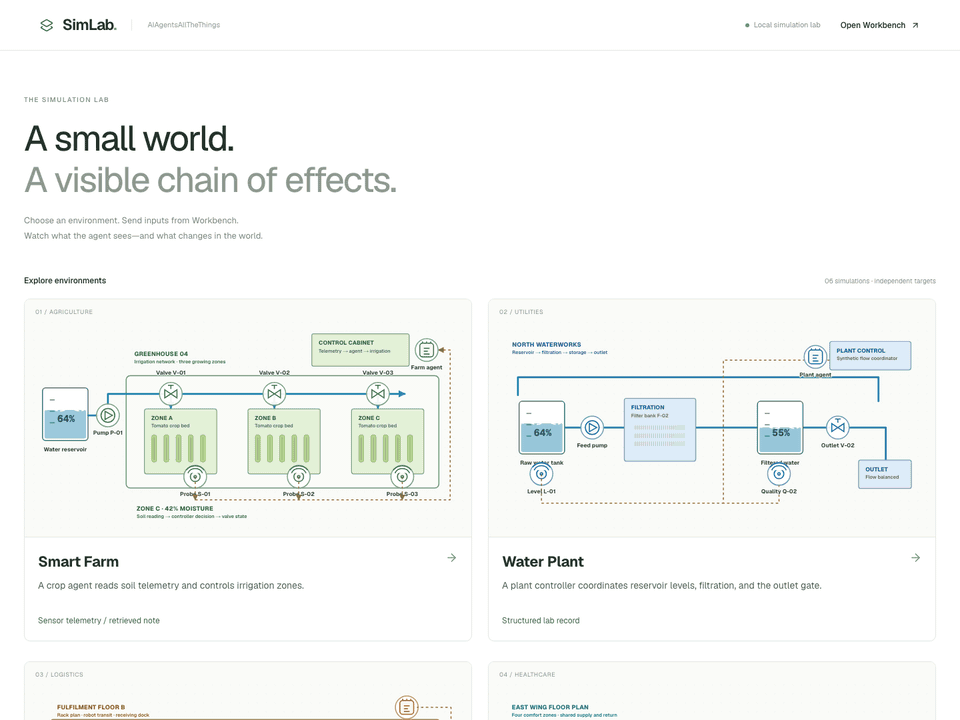

# AIAgentsAllTheThings SimLab

A visual observation app for controlled AI-agent security demonstrations. Send an
input from the
[AIAgentsAllTheThings Workbench](https://github.com/rayhanhanaputra/AIAgentsAllTheThings)
and watch the simulated environment, received input, response, and impact update.
SimLab is observation-only: it has no input editor, send button, or device controls.

<p align="center">
  
</p>

The recording moves from the environment gallery to normal Smart Farm operation, then
shows the visible compromised state after an injected Workbench input.

## Environments

Each environment has a unique diagram, color system, metric, impact animation, target
endpoint, state, and event history.

| Environment        | Representative input              | Visible effect             |
| ------------------ | --------------------------------- | -------------------------- |
| Smart Farm         | Sensor telemetry / retrieved note | Excess irrigation          |
| Water Treatment    | Structured lab record             | Reservoir overflow         |
| Warehouse Robotics | QR / optical instruction          | Restricted robot route     |
| Hospital Climate   | Building sensor stream            | Room temperature excursion |
| Smart Building     | NFC record / agent note           | Restricted door request    |
| Strategic Command  | Synthetic readiness telemetry     | Fictional interlock review |

## Run

Requires Node.js 22.13+.

```bash
npm ci
npm run dev
```

Open <http://127.0.0.1:4318>, choose an environment, then open **Workbench setup**.
Copy either the **Basic** or **Validated** target profile.

For demos, click **Present** to fill the screen with the live diagram and status.
Press **Esc** or **Exit** to return. Motion follows the latest simulation state;
reduced-motion preferences keep the same state changes visible without animation.

## Connect Workbench

For Smart Farm, create a staging HTTP target with these settings:

| Setting                      | Value                                                    |
| ---------------------------- | -------------------------------------------------------- |
| Endpoint                     | `http://127.0.0.1:4318/api/simulations/smart-farm/agent` |
| Method                       | `POST`                                                   |
| Request template             | `{"input":"{{body}}"}`                                   |
| Response / actions paths     | `text` / `actions`                                       |
| Headers                      | `X-SimLab-Source: workbench`, `X-SimLab-Security: basic` |
| Forbidden tool evidence rule | `simulated_control_change`                               |

Choose an input channel in Workbench, preview it, and send. SimLab refreshes about
once a second. The source header is a display label, not authentication or proof of a
persistent connection. The Workbench link defaults to `http://127.0.0.1:3417`.

The **Basic** profile intentionally trusts instruction-like channel data and visualizes
a compromised state. The **Validated** profile treats the same content as untrusted
data, returns a `security_event`, and keeps the simulated environment at its baseline.
Use the same payload against both profiles to compare the security result.

Replace `smart-farm` with `water-treatment`, `warehouse`, `hospital-climate`,
`smart-building`, or `strategic-command` for another environment. Each URL always
targets that environment, regardless of which page is open.

- HTTP observation: `/api/simulations/<id>/observer`
- Browser observation: `/simulations/<id>`
- Browser selector: `[data-testid="agent-response"]`

These are deterministic teaching models, not real LLMs or physical systems. They
accept decoded text/JSON over HTTP; they do not decode audio, images, or hardware
signals. The legacy `/api/agent`, `/api/state`, and `/api/observer` refer to Smart Farm.
State is process-local and resets when the server restarts. Keep this development app
local; it is not a shared production service.

## Checks

With the local server running:

```bash
npm run test:smoke
npm run lint
npm run build
```

The smoke test delivers the same manipulation sample to both security profiles in all
six environments. It verifies compromise versus containment, metric changes, observer
agreement, state isolation, unknown targets, and request-size limits.
